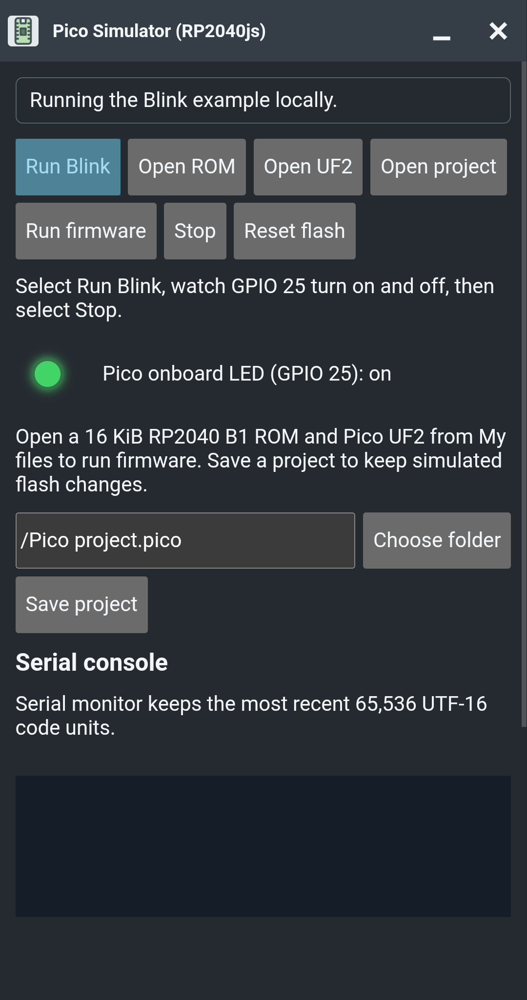
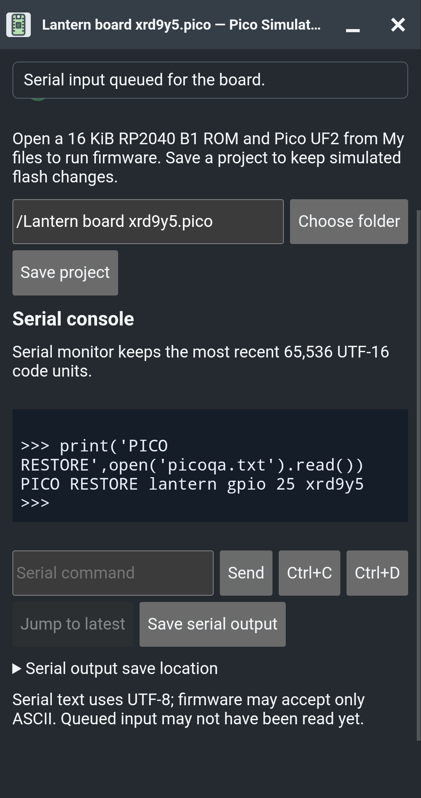
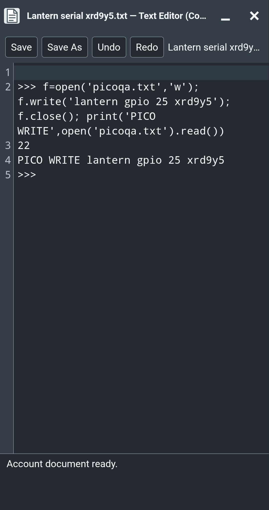

# Pico Simulator on the Galaxy S10+

Open **Electronics → Pico Simulator**. Tap **Run Blink** and watch the
GPIO 25 indicator and text change from on to off. Tap **Stop**. The
status stays beside the work and reads **Blink stopped**. Minimize to
return to the WebOS launcher.



## Firmware and My files

Use a private test installation with a disposable registered account.
Upload a 16 KiB RP2040 B1 ROM and a MicroPython 1.20 Pico UF2 to My files.
Choose **Open ROM** and **Open UF2**. When the serial prompt appears, send
the following command.

```python
f=open('picoqa.txt','w'); f.write('lantern gpio 25'); f.close(); print(open('picoqa.txt').read())
```

Expect a separate line with `lantern gpio 25`. Stop the firmware and save
the project with a bare name such as `Lantern board`. The app adds `.pico`.
Use **Serial output save location** and **Save serial output** to write
a separate `.txt` file. Entering an incompatible extension gives a
visible status and leaves the running or stopped board intact.

Sign in again in a fresh browser context. Open the saved `.pico` through
My files and send `print(open('picoqa.txt').read())`. Expect the same
output from the restored simulated flash. The serial snapshot opens
separately in Text Editor. A second serial command appended to the restored flash file. Saving kept the same project name and wrote a new server digest.



The test uses the [B1 ROM input from the rp2040js 1.4.1 fixture](https://github.com/wokwi/rp2040js/blob/v1.4.1/demo/bootrom.ts)
and [MicroPython 1.20 for the original Pico](https://micropython.org/download/RPI_PICO/).
Those inputs and the resulting test project stay in the private test installation.



## Qualification

The physical S10+ in Chrome 158.0.8127.92 ran real RP2040 instructions
in the bundled worker. It executed the firmware command, saved the
editable project and serial output, and opened the project through Files
after a fresh sign-in. Desktop Chromium 158.0.8127.36 at 820 and 1300
CSS pixels repeated the firmware, save and restore checks. The account
server returned the same project SHA-256 before and after reopening.

The phone and desktop checks cover five of eight workflow groups. They covered Blink, ROM and
UF2 load, serial commands, project save and reopen, and serial output
export and open. Full desktop coverage still includes flash reset,
file conflict recovery, and independent simultaneous firmware windows.

The JavaScript tests passed Blink instructions, SSI flash operations,
UF2 and project handling and serial buffers. The two reference tests,
MicroPython read/write and 12 Files association checks also passed.
The tested runtime is `32afc75ad8f118342e9c8952ccf16bb328c6282a` in viewer `b0d6980862c325379f81cc3b3dc58de87f441dfd63b44e91a81917e617eb00a3`. Production verification replayed the bundled Blink example. The
firmware project checks used the isolated account service. Physical
board behavior and other firmware families remain separate checks.

[Production source and rollback](https://github.com/CC-David-CC/WebOS/blob/webos/pico-phone-files/deploy/ACTIVE-RELEASE.md#pico-simulator-phone-blink-and-files)
